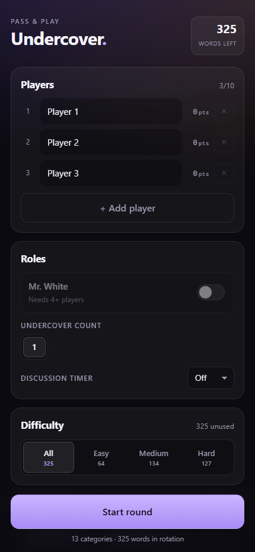
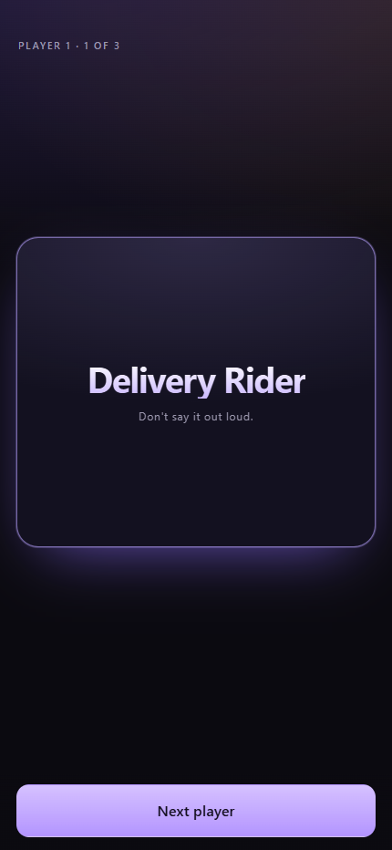

# Undercover & Mr. White

A pass-and-play party game for 3–10 people on one phone. Everyone gets a secret word —
except the undercover player, and Mr. White, who gets nothing at all and has to bluff.

**[Play it](https://abrahamjamesdomingo.github.io/undercover-mr-white/)** · no install on
Android, one tap on iPhone · plays with the network off

 

## Play on a phone

- **iPhone** — open the link in Safari, then **Share → Add to Home Screen**. Open it once
  while online and from then on it runs in airplane mode: the service worker keeps every
  file on the device.
- **Android** — download [`undercover-game.html`](https://github.com/abrahamjamesdomingo/undercover-mr-white/raw/main/undercover-game.html)
  and open it with Chrome. One file, about 83 KB, with all the words inside; no network.
- **Desktop** — the same link. Hold the card with Space or Enter.

## How a round works

1. **Lobby** — 3–10 players, categories, difficulty, Mr. White, undercover count, an
   optional discussion timer.
2. **Pass the phone** — each player presses and holds the card to see a word. Civilians and
   the undercover see a word with no role label; Mr. White sees only a warning.
3. **Discussion** — a randomized speaking order appears. Mr. White never goes first.
4. **Voting** — the table eliminates one player, or skips the vote.
5. **Elimination** — that player's role is revealed. If Mr. White is caught he gets one
   guess at the main word; a correct guess (any capitalisation) wins him the round.
6. **Round over** — both words, every role and the scores, then another round with the same
   table.

Scoring: surviving civilians **+2**, surviving impostors **+4** each, a correct Mr. White
guess **+5**. Names, scores and used words persist on the device.

## Run it locally

No dependencies — Node only.

```bash
node tools/serve.mjs      # http://localhost:5173
node --test "tests/*.test.mjs"
```

Windows PowerShell blocks `npm.ps1` unless script execution is enabled, so either use
`npm.cmd run dev` or the plain `node` commands above.

## Word data

`words.json` holds 13 categories × 25 pairs = **325 pairs**, one per line:

```json
{ "id": "cf14", "main": "Gloves", "impostor": "Mittens", "difficulty": "hard" }
```

`main` is the word civilians (and Mr. White's guess target) share; `impostor` is what the
undercover player gets. `difficulty` describes how close the two are — `hard` pairs are
near-synonyms, `easy` pairs only loosely related. The split is currently 64 easy /
134 medium / 127 hard. Category chips in the lobby are generated from the JSON keys, so a
new category needs no code.

Drawn pairs are remembered in `localStorage` and skipped until the current
category + difficulty pool is exhausted. Each draw swaps main and impostor 50% of the time,
so the undercover player sometimes holds the real word.

## Project layout

| Path | What it is |
| --- | --- |
| `src/` | Game logic and screens: plain ES modules, no framework |
| `words.json` | The 325 word pairs |
| `tests/` | 31 `node:test` tests — word data, drawing, role assignment, scoring, builds |
| `docs/` | Generated installable build, served by GitHub Pages |
| `undercover-game.html` | Generated single-file build for Android |
| `tools/` | Dev server, the two builds, icon renderer, word-data scripts |
| `Project_Undercover_and_Mr_White.md` | The original design spec |

Both builds are committed, so regenerate them after editing `src/` or `words.json`:

```bash
node tools/build-standalone.mjs   # -> undercover-game.html
node tools/build-pwa.mjs          # -> docs/
```
